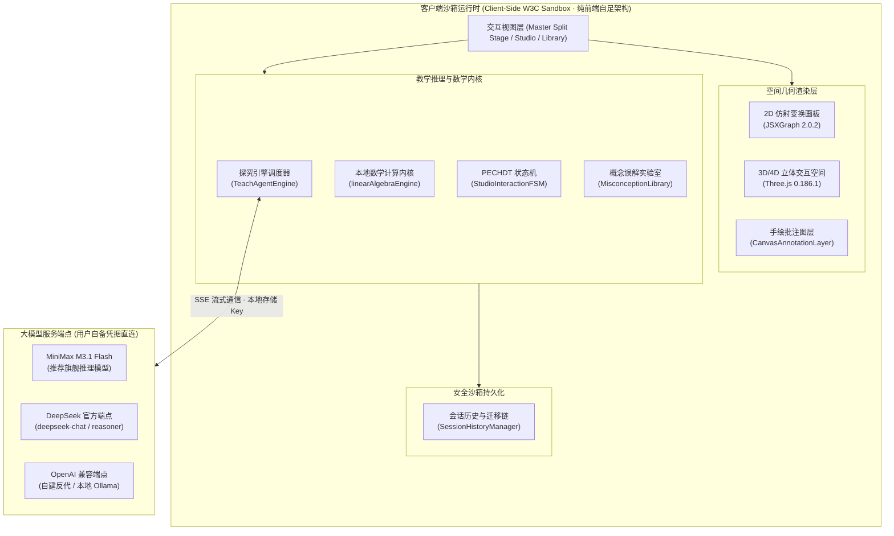
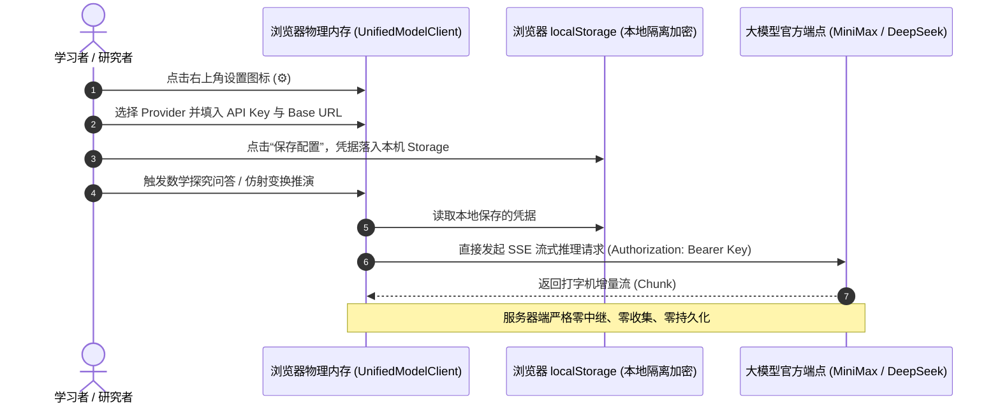

# 问矩 · 线性代数实验式探究智能助教平台 (Wenju Agent)

<p align="center">
  
  
  
  
</p>

> **“让矩阵在空间中舒展，探寻代数几何本质。”**  
> 《问矩》（Wenju Agent）是一套专为线性代数与几何变换打造的**纯前端单页架构（SPA）实验式探究智能教学助教平台**。系统将大语言模型的认知引导与确定性本地数学几何计算内核物理隔离，学习者通过指针直观拖动基向量、触碰多维超立方体并进行手绘圈画批注，在建构主义“六步探究法”中实现从几何直觉到代数形式化的深度建构。

---

## 目录

- [一、 核心愿景与教学哲学](#一-核心愿景与教学哲学)
- [二、 核心系统特性](#二-核心系统特性)
- [三、 整体系统架构](#三-整体系统架构)
- [四、 开箱即用与快速启动](#四-开箱即用与快速启动)
- [五、 大模型接入与 API Key 配置指南](#五-大模型接入与-api-key-配置指南)
- [六、 平台核心目录规范（最小闭包）](#六-平台核心目录规范最小闭包)
- [七、 118 页全栈技术白皮书](#七-118-页全栈技术白皮书)
- [八、 开源许可证](#八-开源许可证)

---

## 一、 核心愿景与教学哲学

传统线性代数教学长期面临三大核心矛盾：
1. **符号运算与几何直觉割裂**：行列式、特征值与秩常被退化为机械式的代数公式演算，学习者难以建立空间变换与维度坍缩的几何表象；
2. **生成式 AI 的计算幻觉与不可控性**：通用大语言模型在推导复杂矩阵运算时易产生数值幻觉，直接生成答案更容易破坏学习者的自主思考；
3. **传统仿真软件缺乏交互引导**：MATLAB 或 GeoGebra 等工具虽然具备数值计算能力，但缺乏苏格拉底式的分步引导与认知冲突诊断机制。

为此，《问矩》确立了**建构主义“PECHDT”六步探究教学范式**：

```mermaid
graph LR
    P[1. Predict 预测] --> E[2. Experiment 实验]
    E --> C[3. Conflict 认知冲突]
    C --> H[4. Hypothesis 假说]
    H --> D[5. Deduce 推导]
    D --> T[6. Test 迁移验证]
    
    style P fill:#e0f2fe,stroke:#0284c7,stroke-width:2px
    style E fill:#e0f2fe,stroke:#0284c7,stroke-width:2px
    style C fill:#fee2e2,stroke:#ef4444,stroke-width:2px
    style H fill:#fef3c7,stroke:#f59e0b,stroke-width:2px
    style D fill:#f0fdf4,stroke:#22c55e,stroke-width:2px
    style T fill:#f0fdf4,stroke:#22c55e,stroke-width:2px
```



* **Predict（几何预测）**：在执行变换前，引导学习者预测平行四边形面积增减或手性反转；
* **Experiment（动态实验）**：在交互画布上直接拖拽基向量 $\mathbf{v}_1, \mathbf{v}_2$，物理计算内核实时渲染仿射变换面域；
* **Conflict（冲突暴露）**：将学习者的先验猜测与真实空间事实对照，主动暴露反事实误解（如认为行列式可加）；
* **Hypothesis（形成假说）**：将几何表象抽象为代数命题（如列向量共线导致行列式坍缩为零）；
* **Deduce（符号推导）**：助教大模型介入，基于客户端确定性计算结果展开启发式形式化证明；
* **Test（变式检验）**：从变式题库抽取同构题型进行多维迁移验证，闭环巩固概念。

---

## 二、 核心系统特性

### 1. 2D 仿射变换与基底几何画板 (JSXGraph 深度集成)
* **基底指针直接操控**：将矩阵 $\begin{pmatrix} a & b \\ c & d \end{pmatrix}$ 的四个参数直接具象化为二维平面中由原点出发的可拖动基向量箭头；
* **行列式手性与符号面积**：实时计算绿色半透明平行四边形面域，当基底顺逆时针翻转时触发手性颜色突变（逆时针正常色，顺时针突变为琥珀告警色）；
* **奇异降维与核空间流形**：动态展示当 $\det(A) = 0$ 时二维平面坍缩为一条直线或原点的几何过程，并显式绘制核空间（Null Space / Kernel）正交投影线。

### 2. 3D/4D 立体几何交互空间 (Three.js 引擎)
* **四维超立方体（Tesseract / 8-cell）实时投影**：内置 4D 正交与透视投影旋转算子，支持三维视口下对四维旋转张量进行直观感知；
* **四元数球面插值（Slerp）**：杜绝欧拉角万向节死锁，确保三维坐标轴与网格地平面的平滑交互；
* **WebGL 上下文丢失防御机制**：动态捕获 `webglcontextlost` 事件并实现轻量场景自愈重建。

### 3. 双层离屏手绘圈画批注层 (CanvasAnnotationLayer)
* **相邻中点二次贝塞尔平滑算法 (Midpoint Quadratic Bezier Smoothing)**：消除高分屏下鼠标/触控板高频抖动，渲染圆润锐利的标注线；
* **双层离屏光栅化合成**：支持一键将“底图几何状态 + 顶层手绘圈画”合并为单个高清 Base64 图元，直传大模型展开视觉感知。

### 4. 反事实概念误解实验室 (MisconceptionLibrary)
* 系统内置 **32 条结构化线性代数反事实概念误解库** 与 6 大高频盲区推演卡片（矩阵乘法不可交换、零因子存在性、行列式可加性佯谬、转置与逆的顺序、秩不等式、特征值实根存在性）；
* 输入任意 $2 \times 2$ 矩阵，本地算法秒级搜索并构造反例矩阵，直观呈现分步乘积验证。

### 5. 纯前端 W3C 标准沙箱运行时
* **零外部服务依赖**：核心平台完全依托浏览器原生能力运行，不依赖 Node.js/Python 编译链即可完整工作；
* **本地确定性数学内核**：剥离大模型直接输出数值的权限，所有行列式、特征值、秩、逆矩阵计算排他性由客户端 `linearAlgebraEngine.js` 物理计算生成。

---

## 三、 整体系统架构



---

## 四、 开箱即用与快速启动

本系统为**纯前端无构建依赖架构**，克隆后即可直接运行。

### 方式一：纯前端静态启动（最推荐）

本平台所有第三方核心依赖（Three.js、JSXGraph、Marked）已在 `libs/` 中完成本地化封装，直接启动任意 HTTP 静态服务器即可：

```bash
# 1. 克隆代码仓库
git clone https://github.com/Alpacandy/wenju-agent.git
cd wenju-agent

# 2. 启动静态服务器 (任选一种可用方式)
# 使用 Python 启动
python -m http.server 8000 --bind 127.0.0.1

# 或使用 npx serve
npx serve -l 8000 .

# 或使用 npm 快捷命令
npm run dev
```

打开现代浏览器（Chrome / Edge / Firefox / Safari）访问：  
👉 **`http://127.0.0.1:8000`**

### 方式二：启用轻量伴随宿主服务（可选）

若需要启用本地文件工作区读写、SQLite 会话归档持久化等高级扩展能力，可启动随附的 Node 服务（采用 Node 22 内置 `node:sqlite`，零外置数据库安装）：

```bash
# 启动配套服务
npm run server
```

---

## 五、 大模型接入与 API Key 配置指南

为恪守用户隐私与安全底线，**本开源项目绝不内置任何私有 API Key，亦不在服务端收集或持久化用户的凭证**。学习者拿到平台后，只需接入自己的 API Key 即可全功能畅玩：



### 具体配置步骤：
1. 打开平台网页，点击顶栏右上角 **“设置（⚙️）”** 图标；
2. 选择要接入的模型服务提供商：
   * **MiniMax 旗舰推理**（原生支持深度交错思考链与工具调度，推荐模型：`MiniMax-M3.1-Flash`）；
   * **DeepSeek 官方端点**（Base URL 默认 `https://api.deepseek.com`，推荐模型：`deepseek-chat` 或 `deepseek-reasoner`）；
   * **自定义端点 (Custom Provider)**：支持任意标准兼容 OpenAI 格式的反代地址、vLLM 或本地 Ollama 实例；
3. 填入您的专属 **API Key**，点击 **“测试连接与工具”** 按钮进行连通性探针校验；
4. 校验成功后点击 **“保存配置”**。凭据仅加密存放在当前浏览器宿主，关闭网页后安全保全，随时可在设置中点击“清除已保存密钥”。

---

## 六、 平台核心目录规范（最小闭包）

开源仓库严格遵守“最小可运行闭包”原则，除去了内部过程文档、临时探针与测试套件，保持目录极简纯粹：

```text
wenju-agent/
├── README.md                      # 项目说明书与快速指引
├── LICENSE                        # Apache-2.0 开源协议
├── package.json                   # 项目元信息与启动脚本
├── index.html                     # 纯前端单页架构入口
├── css/                           # 核心系统样式 (style.css, artifact-workspace.css 等)
├── libs/                          # 本地化权威库 (JSXGraph, Three.js, Marked)
├── components/                    # 14 个高内聚前端组件 (画板层、推演卡片、时空穿梭器)
├── js/                            # 平台核心逻辑 (数学引擎、多智能体调度、认知误解库)
├── media/videos/                  # 真实 Manim 720p30 几何微课切片
├── server/                        # 可选伴随宿主服务 (SQLite 持久化与工作区)
├── deploy/                        # 生产部署模板 (Nginx 独立端口零缓冲配置)
└── docs/report/
    └── main.pdf                   # 118 页全栈技术白皮书高清无损 PDF
```

---

## 七、 118 页全栈技术白皮书

本项目伴随有完整的工业级技术白皮书：  
📄 **[《问矩 · 线性代数实验式探究智能助教全栈技术白皮书》 (docs/report/main.pdf)](docs/report/main.pdf)**

* **篇幅与规格**：118 页，包含 29 个章节，980,582 字节无损排版；
* **核心内容涵盖**：
  * 建构主义认知模型形式化数学表达；
  * 双向同构坐标变换公式与四元数球面插值算法证明；
  * 浏览器端轻量 Schema 校验器与工具近邻歧义过滤（ToolNeighborGuard）状态机；
  * 生产环境 Nginx 独立端口 8888 零侵扰、零闪断与流式穿透部署实践。

欢迎高校计算机、人工智能及数学教学改革团队参阅与引用。

---

## 八、 开源许可证

本项目基于 [Apache License 2.0](LICENSE) 协议开源。欢迎广大师生与开发者共同完善线性代数智能探究生态！
